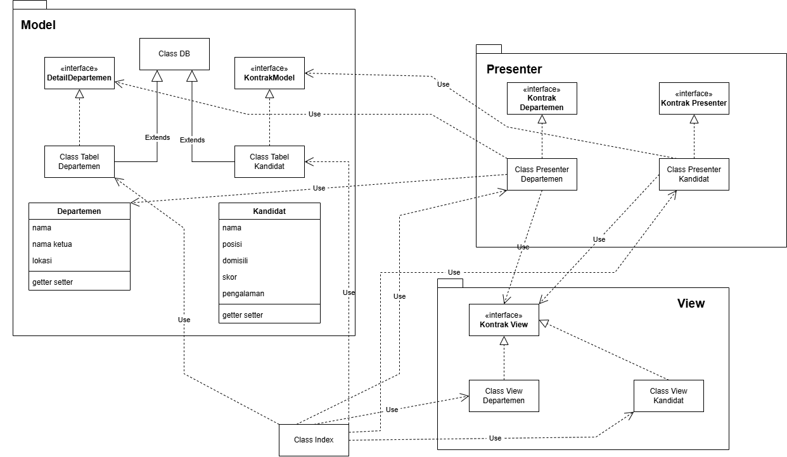

# Janji
Saya Nezhad Ahmad Maliki dengan NIM 2503880 mengerjakan Tugas Praktikum 9 pada Mata Kuliah Desain dan Pemrograman Berorientasi Objek (DPBO) untuk keberkahan-Nya maka saya tidak melakukan kecurangan seperti yang telah dispesifikasikan. Aamiin

# Struktur File

```
C:.
│   index.php
│   mvp_db.sql
│   README.md
│
├───models
│       DB.php
│       Departemen.php
│       DetailDepartemen.php
│       Kandidat.php
│       KontrakModel.php
│       TabelDepartemen.php
│       TabelKandidat.php
│
├───presenters
│       KontrakDepartemen.php
│       KontrakPresenter.php
│       PresenterDepartemen.php
│       PresenterKandidat.php
│
├───template
│       form.html
│       form_departemen.html
│       skin.html
│       skin_departemen.html
│
└───views
        KontrakView.php
        ViewDepartemen.php
        ViewKandidat.php
```

# Fungsi program & Alur Program
# Fungsi program & Alur Program
Program pengelolaan data Lectures dan Courses dibuat untuk membantu pengguna dalam mengelola data dosen dan mata kuliah melalui sebuah website. Program ini menyediakan fitur untuk menampilkan, menambahkan, mengubah, dan menghapus data yang tersimpan di dalam database.

Program ini memiliki dua bagian utama, yaitu pengelolaan data Lectures dan pengelolaan data Courses. Pada bagian Lectures, pengguna dapat mengelola informasi dosen, seperti nama, NIDN, nomor telepon, dan tanggal bergabung. Sementara itu, pada bagian Courses, pengguna dapat mengelola informasi mata kuliah, seperti nama mata kuliah, kode mata kuliah, jumlah SKS, serta dosen pengampu.

Program ini dibuat menggunakan bahasa pemrograman PHP dengan konsep Object-Oriented Programming (OOP), menerapkan pola arsitektur Model-View-Controller (MVC), serta menggunakan MySQL sebagai database untuk menyimpan seluruh data.

Program ini dibuat menggunakan PHP dengan konsep Object-Oriented Programming (OOP) dan database MySQL sebagai tempat penyimpanan seluruh data.

### Desain Class
Program ini menggunakan beberapa class yang memiliki tugas dan tanggung jawab masing-masing. Setiap class dipisahkan ke dalam folder berdasarkan fungsinya agar kode program lebih terstruktur dan mudah dikelola.

Berikut merupakan penjelasan class yang digunakan:

##Folder Model :

Class DB: Bertugas untuk mengatur koneksi antara program PHP dengan database MySQL, menjalankan perintah SQL, dan mengambil hasil query.

Class Kandidat: Bertugas untuk merepresentasikan data kandidat, seperti ID, nama, posisi, domisili, skor tes, dan pengalaman tahun.

Class TabelKandidat: Bertugas untuk mengelola data kandidat, seperti menampilkan seluruh data, mengambil data berdasarkan ID, menambahkan, mengubah, dan menghapus data kandidat.

Class Departemen: Bertugas untuk merepresentasikan data departemen, seperti ID departemen, nama departemen, nama ketua departemen, dan lokasi departemen.

Class TabelDepartemen: Bertugas untuk mengelola data departemen, seperti menampilkan seluruh data, mengambil data berdasarkan ID, menambahkan, mengubah, dan menghapus data departemen.

##Folder Presenter :

Class PresenterKandidat: Bertugas untuk mengatur alur pengelolaan data kandidat. Presenter mengambil data dari Model, mengolah data yang diperlukan, dan mengirimkan hasilnya ke View untuk ditampilkan.

Class PresenterDepartemen: Bertugas untuk mengatur alur pengelolaan data departemen dengan mengambil data dari Model, mengolahnya, dan mengirimkan hasilnya ke View.

##Folder View

Class ViewKandidat: Bertugas untuk menampilkan halaman pengelolaan data kandidat, termasuk tabel data kandidat serta form tambah dan edit.

Class ViewDepartemen: Bertugas untuk menampilkan halaman pengelolaan data departemen, termasuk tabel data departemen serta form tambah dan edit.

##Interface
Class KontrakModel, DetailDepartemen, KontrakView, KontrakPresenter, dan KontrakDepartemen: Bertugas sebagai interface yang menentukan method atau aturan yang harus diterapkan oleh class yang mengimplementasikannya.

### Alur Program (Flow Kode), Alur Design

Alur program dimulai ketika pengguna membuka website melalui file index.php. File tersebut berfungsi sebagai pintu masuk utama program untuk mengakses halaman pengelolaan data Kandidat dan Departemen. Selanjutnya, index.php memanggil Model, View, dan Presenter yang diperlukan untuk menjalankan program.

Pada halaman Kandidat, program menampilkan data kandidat yang diambil dari database. Pengguna dapat melakukan beberapa tindakan, yaitu:

Menampilkan data (Read)

PresenterKandidat memanggil method pada TabelKandidat untuk mengambil seluruh data kandidat dari database. Data yang diperoleh kemudian diolah oleh PresenterKandidat dan dikirimkan ke ViewKandidat untuk ditampilkan dalam bentuk tabel.

Menambahkan data (Create)

Pengguna mengisi form yang tersedia dengan informasi kandidat. Setelah tombol Simpan ditekan, data dikirim melalui method POST ke index.php. Selanjutnya, PresenterKandidat memanggil method tambah pada TabelKandidat untuk menyimpan data kandidat ke database.

Mengubah data (Update)

Pengguna memilih tombol Edit pada salah satu data kandidat. Program mengambil data berdasarkan ID melalui TabelKandidat, kemudian PresenterKandidat mengirimkan data tersebut ke ViewKandidat untuk ditampilkan kembali ke dalam form. Setelah pengguna mengubah informasi dan menekan tombol Update, PresenterKandidat memanggil method update pada TabelKandidat untuk memperbarui data di database.

Menghapus data (Delete)

Pengguna memilih tombol Hapus pada data kandidat yang ingin dihapus. ID kandidat dikirim melalui method POST ke index.php. Selanjutnya, PresenterKandidat memanggil method delete pada TabelKandidat untuk menghapus data tersebut dari database.

Selain halaman Kandidat, terdapat halaman Departemen yang dapat diakses melalui tombol navigasi Departemen. Halaman ini menggunakan index.php dengan parameter halaman untuk menentukan bagian yang akan ditampilkan, kemudian memanggil PresenterDepartemen.

Pada halaman Departemen, pengguna dapat melihat, menambahkan, mengubah, dan menghapus data departemen. Proses pengelolaan data dilakukan melalui PresenterDepartemen yang berkomunikasi dengan TabelDepartemen untuk mengambil maupun mengubah data di database. Hasil pengolahan data kemudian dikirimkan ke ViewDepartemen untuk ditampilkan kepada pengguna.

Setelah proses tambah, edit, atau hapus dilakukan, program mengarahkan pengguna kembali ke halaman terkait agar data terbaru dapat ditampilkan.

Program ini menggunakan database MySQL dengan nama mvp_kandidat_db sebagai tempat penyimpanan seluruh data.

Database tersebut memiliki dua tabel utama, yaitu:

Tabel kandidat: Menyimpan informasi kandidat yang terdiri dari ID, nama, posisi, domisili, skor tes, dan pengalaman tahun.

Tabel departemen: Menyimpan informasi departemen yang terdiri dari ID departemen, nama departemen, nama ketua departemen, dan lokasi departemen.

Koneksi database dikelola melalui class DB yang terdapat pada folder models. Sementara itu, class TabelKandidat dan TabelDepartemen menggunakan class DB untuk menjalankan query ke database. Dengan demikian, proses koneksi dan pengolahan database dilakukan melalui class yang sudah disediakan tanpa harus menuliskan koneksi database secara berulang pada setiap class Model.

### Desain Framework




# Dokumentasi

## page kandidat


## page departemen

